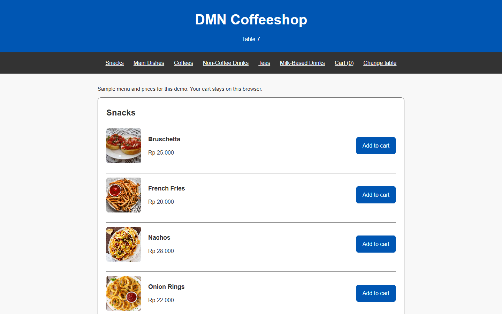
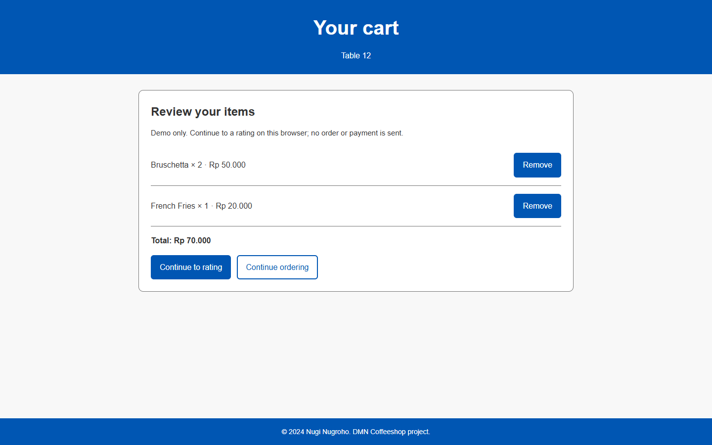

# DMN Coffee

Demo pemesanan menu berdasarkan nomor meja dengan Java Servlet, JSP, dan MySQL. Pengunjung memilih meja, mengambil menu dari database, menambahkan item ke keranjang, lalu memberi rating di browser.

**Batas demo:** keranjang dan rating disimpan di `localStorage`. Tidak ada pengiriman pesanan ke kasir, pembayaran, akun pengguna, atau penyimpanan rating ke server. Menu dan harga pada seed SQL adalah contoh untuk mencoba aplikasi.



*Contoh menu untuk meja 7 pada demo lokal.*

<details>
<summary>Lihat contoh keranjang</summary>



*Contoh sesi terpisah untuk meja 12. Keranjang tersimpan di browser; tidak ada pesanan atau pembayaran yang dikirim.*

</details>

## Jalankan dengan Docker

Siapkan Docker Desktop yang mendukung Linux containers dan Docker Compose. Jalankan perintah berikut di PowerShell:

```powershell
git clone https://github.com/zalamanga/dmn-coffee.git
cd dmn-coffee
Copy-Item .env.example .env
```

Buka `.env`, ganti `DB_PASSWORD` dengan password demo lokal pilihanmu, lalu jalankan:

```powershell
docker compose up --build -d
```

Buka **http://localhost:18092**, masukkan nomor meja 1 sampai 999, lalu pilih **Browse the menu**. Build pertama perlu mengunduh image dan dependency Maven. Database akan diisi otomatis ketika volume datanya pertama kali dibuat.

```powershell
docker compose ps                  # Periksa apakah database sudah healthy
docker compose logs --tail=80 web  # Lihat log aplikasi jika menu gagal dimuat
docker compose down                # Hentikan aplikasi; data menu tetap tersimpan
```

Di macOS atau Linux, ganti `Copy-Item .env.example .env` dengan `cp .env.example .env`. Jangan commit `.env`; file ini sudah diabaikan Git. Compose mengikat port aplikasi ke komputer lokal dan tidak membuka port MySQL ke host.

## Yang bisa dicoba

| Alur | Perilaku |
| --- | --- |
| Pilih meja | Form dan servlet memvalidasi bilangan bulat 1 sampai 999. |
| Lihat menu | Servlet membaca tabel `menu_items`; JSP menampilkan kategori, gambar, dan harga. |
| Tambah item | Item yang sama menambah jumlahnya; jumlah maksimum 99 per item. |
| Buka ulang keranjang | Isi keranjang tetap ada setelah reload pada browser dan origin yang sama. |
| Hapus item | Baris item dihapus dan total dihitung ulang. Keranjang kosong menonaktifkan tombol lanjut. |
| Ganti meja | Keranjang dibersihkan agar item meja sebelumnya tidak tercampur. |
| Beri rating | Nilai 1 sampai 5 disimpan di browser untuk meja tersebut; keranjang demo dikosongkan. |

Harga dan isi keranjang pada browser dapat diubah melalui developer tools. Gunakan server untuk memvalidasi harga, menyimpan pesanan, dan memproses pembayaran jika proyek dikembangkan menjadi aplikasi transaksi.

## Susunan proyek

```text
database/001-menu.sql                   Tabel menu dan data contoh
src/main/java/DB/                       Koneksi JDBC dari environment
src/main/java/com/dmn/coffeeshop/
  model/                               Model MenuItem
  servlets/                            MenuItemsServlet
src/main/webapp/
  WEB-INF/views/menu.jsp                Tampilan menu, diakses melalui servlet
  index.html                           Pilih meja
  cart.html                            Keranjang lokal
  rating.html                          Rating lokal
  css/  js/  images/                    Tampilan, perilaku browser, dan gambar asal
src/test/java/                         Pengujian servlet dan konfigurasi database
pom.xml                                Build Maven menjadi WAR
Dockerfile                             Build Java dan runtime Tomcat
compose.yaml                           Aplikasi dan MySQL
```

Request menu mengalir dari `index.html` ke `MenuItemsServlet`, lalu JDBC/MySQL dan `WEB-INF/views/menu.jsp`. JSP tidak dibuka langsung agar data selalu disiapkan oleh servlet. Aplikasi memakai namespace `javax.servlet`; gunakan [Tomcat 9 yang mendukung Servlet 4.0 dan JSP 2.3](https://tomcat.apache.org/tomcat-9.0-doc/), bukan Tomcat 10/11 tanpa migrasi ke `jakarta.servlet`.

## Build tanpa Docker

Siapkan JDK 17, Maven 3.9, Tomcat 9, dan MySQL 8.4. Buat database `dmn_coffee`, impor `database/001-menu.sql`, lalu buat pengguna database yang dapat membaca tabel `menu_items`.

```powershell
mvn verify
```

Hasil build ada di `target/dmn-coffee.war`. Atur environment berikut pada **proses Tomcat**, kemudian deploy WAR ke direktori `webapps`:

| Variabel | Contoh / fungsi |
| --- | --- |
| `DB_URL` | `jdbc:mysql://localhost:3306/dmn_coffee?serverTimezone=UTC` |
| `DB_USER` | Nama pengguna database yang kamu buat. |
| `DB_PASSWORD` | Password pengguna database tersebut. |

Jika WAR bernama `dmn-coffee.war` dan Tomcat memakai port 8080, buka `http://localhost:8080/dmn-coffee/`. `.env` hanya dibaca oleh [Docker Compose untuk interpolasi konfigurasi](https://docs.docker.com/compose/how-tos/environment-variables/variable-interpolation/); Java/Tomcat yang dijalankan sendiri tidak otomatis membacanya. Live Server VS Code dan membuka HTML langsung tidak menjalankan servlet/JSP.

## Ubah menu dan tangani masalah

- Port 18092 sudah dipakai: ubah `APP_PORT` di `.env`, lalu jalankan kembali `docker compose up -d`.
- Menu menampilkan pesan gagal: periksa `docker compose ps` dan log `web`. Cocokkan password aplikasi dengan pengguna MySQL yang sudah tersimpan.
- Menu kosong: tabel ada tetapi belum berisi item. Impor seed ke database demo yang sesuai atau masukkan data sendiri.
- Mengedit seed SQL tidak mengubah database yang sudah dibuat. Script init MySQL hanya berjalan pada volume baru; untuk database yang ada, terapkan perubahan SQL secara sengaja.
- Mengganti `DB_PASSWORD` tidak otomatis mengubah password pengguna pada volume MySQL lama. Ubah password pengguna database itu juga sebelum memulai ulang aplikasi.
- Keranjang tidak tersimpan: izinkan penyimpanan situs pada browser. Aplikasi menampilkan pesan jika penyimpanan diblokir.

Data browser memakai key `dmnCoffee.table`, `dmnCoffee.cart`, dan `dmnCoffee.rating`. `localhost` dan `127.0.0.1`, port berbeda, atau browser berbeda mempunyai penyimpanan yang terpisah.

## Asal proyek

Versi ini dirapikan dari DMNCoffeeshop berbasis NetBeans/Ant. Atribusi **Nugi Nugroho, 2024** pada sumber asli dipertahankan. Gambar menu berasal dari folder proyek lama; asal dan lisensi masing-masing gambar belum didokumentasikan. Repo ini tidak menambahkan lisensi baru atau mengklaim seluruh aset sebagai karya pemilik akun GitHub.
