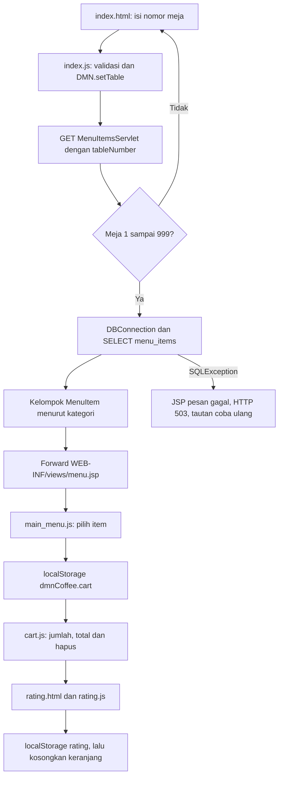

# Alur kode DMN Coffee

Menu dibaca dari MySQL melalui Java Servlet/JSP. Nomor meja, keranjang, dan rating berada di browser. Alur ini tidak menyimpan pesanan atau pembayaran ke database.

## Dari meja ke menu server

[`index.js`](../src/main/webapp/js/index.js) memakai helper [`common.js`](../src/main/webapp/js/common.js) untuk memeriksa meja dan menyimpannya sebelum form dikirim. `DMN.setTable()` membersihkan keranjang jika meja berganti. Bila penyimpanan gagal, form tidak dilanjutkan dan halaman menampilkan pemberitahuan.

[`MenuItemsServlet.doGet()`](../src/main/java/com/dmn/coffeeshop/servlets/MenuItemsServlet.java) memvalidasi parameter `tableNumber` kembali sebagai bilangan bulat 1–999. Nilai salah diarahkan ke `index.html?invalidTable=1`. Nilai benar menjadi atribut request, kemudian `loadMenuGroups()` membaca `menu_items` dengan query tetap dan mengelompokkan hasil sebagai `MenuItem` per kategori.

[`DBConnection.getConnection()`](../src/main/java/DB/DBConnection.java) memerlukan `DB_URL`, `DB_USER`, dan `DB_PASSWORD` pada proses Tomcat. URL harus JDBC MySQL; batas koneksi dan pembacaan masing-masing lima detik. `Connection`, `PreparedStatement`, serta `ResultSet` ditutup oleh try-with-resources.

Servlet meneruskan request ke [`WEB-INF/views/menu.jsp`](../src/main/webapp/WEB-INF/views/menu.jsp). JSP menampilkan kategori, gambar, harga, dan data tombol untuk JavaScript. Halaman ini berada di `WEB-INF`, sehingga pengunjung membuka servlet untuk memperoleh data yang sudah disiapkan. Menu kosong dan query gagal mempunyai pesan berbeda; kegagalan database menghasilkan HTTP 503 dengan tautan coba ulang.

## Dari pilihan ke keranjang lokal

[`main_menu.js`](../src/main/webapp/js/main_menu.js) membaca item dari tombol menu. Item yang sama menaikkan `quantity` sampai 99. Script memastikan meja pada halaman masih cocok dengan meja tersimpan sebelum menambah item, agar tab lama tidak memasukkan pilihan ke meja lain.

`DMN.cart()` memeriksa bentuk data browser sebelum dipakai. [`cart.js`](../src/main/webapp/js/cart.js) membentuk baris memakai DOM/textContent, menghitung total `price × quantity`, menghapus item, dan menonaktifkan tombol lanjut saat keranjang kosong atau meja belum dipilih. Event `pageshow` dan `storage` memperbarui tampilan ketika kembali ke halaman atau data berubah di tab lain.

Harga keranjang berasal dari data yang sudah dikirim ke browser, lalu tersimpan lokal. Pengguna dapat mengubahnya melalui developer tools; angka ini tidak menjadi dasar transaksi server.

## Rating dan batas data

[`rating.js`](../src/main/webapp/js/rating.js) menerima nilai 1–5 untuk meja saat halaman dibuka. Jika meja berubah di tab lain, pengguna diminta kembali ke keranjang. Rating ditulis ke `dmnCoffee.rating`, kemudian keranjang dikosongkan. Pesan selesai tampil setelah kedua penulisan berhasil; penyimpanan browser tersebut bukan transaksi database.

`common.js` menggunakan tiga key: `dmnCoffee.table`, `dmnCoffee.cart`, dan `dmnCoffee.rating`. Data JSON yang rusak dipulihkan dengan pemberitahuan. Origin/browser berbeda mempunyai data berbeda. Tidak ada POST pesanan/rating ke MySQL; tabel seed [`database/001-menu.sql`](../database/001-menu.sql) hanya memasok menu contoh.
